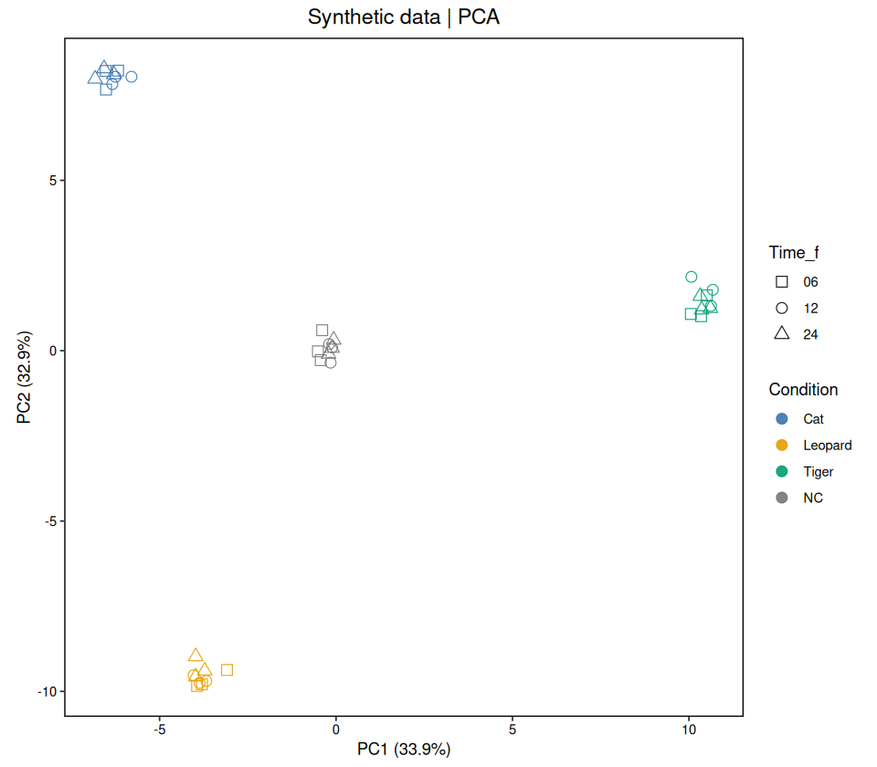
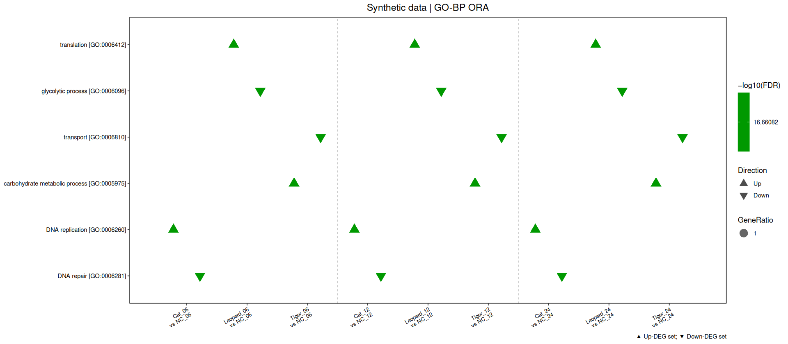
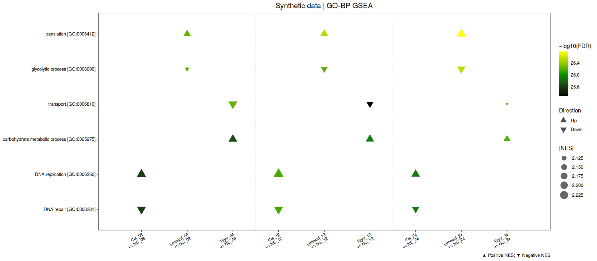

# Calicivirus transcriptome · targets 工程

复用现有R6转录组基座，以targets组织输入、分组、九个默认比较、GO-BP/KEGG富集、原始风格绘图和组合导出。统计与绘图分离，结果缓存由targets管理。

## 快速运行

在已有转录组R环境中先补充工程依赖：`install.packages(c("targets", "yaml", "renv"))`。也可以按下文使用renv快照恢复完整环境。

首次运行建立新缓存；之后根据依赖增量执行，不直接导入旧流程的大型绘图RDS。

将工程代码放在项目顶层，使 `_targets.R`、`R/`、`config/` 与 `00.database/`、`02.Quant_定量结果_Calicivirus/`、`gene2go.gz` 同级。

```r
setwd("/work/home/acx2ojxu3z/zz_杯状病毒转录组数据分析_2026年10月19日")
source("scripts/check_environment.R")
targets::tar_manifest()
targets::tar_visnetwork() # 可选，需要visNetwork包
targets::tar_make()
```

默认输出为 `04_targets_analysis/`，targets缓存为 `_targets/`。旧流程仍位于 `analysis_scripts/`；本工程没有覆盖旧 `03_analysis/`。

也可以把代码仓库放在单独目录，并在启动R后指定数据项目路径：

```r
Sys.setenv(TRANSCRIPTOME_PROJECT_DIR = "/work/home/acx2ojxu3z/zz_杯状病毒转录组数据分析_2026年10月19日")
targets::tar_make()
```

此时工作目录仍是包含 `_targets.R` 的代码根目录；配置中的相对输入路径及输出路径均相对 `TRANSCRIPTOME_PROJECT_DIR`。

## 配置入口

| 文件 | 用途 |
|---|---|
| `config/paths.yml` | count、样本表、GTF、gene2go和输出路径 |
| `config/variables.yml` | 变量类型、factor顺序、派生变量和组合分组 |
| `config/comparisons.yml` | 比较变量、参考水平、分层和显式组对 |
| `config/analysis.yml` | 拟合方法与独立的DEG筛选阈值 |
| `config/reference.yml` | 参考物种、tax_id、GO祖先传播及KEGG快照 |
| `config/enrichment.yml` | 基因集大小和GSEA种子 |
| `config/figures.yml` | 原始主题、映射变量、代表条目、输出像素预算 |

可以设置 `TRANSCRIPTOME_CONFIG_DIR` 使用另一套完整配置目录。配置不支持执行YAML中的R表达式。

## 样本表与变量组合

默认兼容已有 `Sample/Group` 或 `Samples/Group` 表，通过显式开启的 `legacy_parse` 解析现有命名。新项目推荐提供完整元数据并设置 `legacy_parse: false`：

| Sample | Condition | Time_f | Replicate | Batch |
|---|---|---|---|---|
| Cat_06_1 | Cat | 06 | 1 | B1 |
| NC_06_1 | NC | 06 | 1 | B1 |

分类时间使用 `Time_f`；数值时间使用派生 `Time_h`，06/12/24在本配置中分别转换为6/12/24，单位按实验记录确认。Replicate仅为重复编号，不自动解释为跨时间配对个体。

分类变量需声明levels，水平顺序用于表格和图像。新增变量后，可组合任意已声明的分类列：

```yaml
variables:
  Batch:
    type: factor
    levels: [B1, B2]
combinations:
  Condition_Time_Batch:
    variables: [Condition, Time_f, Batch]
    order: [Time_f, Condition, Batch]
    separator: '_'
```

以上片段需合并到现有variables/combinations映射中。组合只保留实际观测到的样本组；若不同变量组合生成同一标签，会要求更换分隔符。

工程保留 `Condition = Cat/Leopard/Tiger/NC` 作为现有实验编码，HostSpecies为前述狮子宿主，NCBI参考物种为家猫；实验处理或病毒来源的具体含义请以实验元数据说明为准。

## 比较方案

默认启用的 `baseline` 在每个Time_f内，分别比较Cat、Leopard、Tiger与NC，生成原九个比较。

启用 `time_within_condition` 可在每个Condition内比较12/24与06；该方案与baseline有独立Scheme/Job ID和输出目录，避免文件覆盖。

自定义分类交叉组的比较例子：

```yaml
schemes:
  - id: condition_per_time_batch
    enabled: true
    type: pairwise
    group: Condition_Time_Batch
    variable: Condition
    reference: NC
    treatments: [Cat, Leopard, Tiger]
    strata: [Time_f, Batch]
```

每个分层内，两侧必须各对应一个组合分组，且每组至少有 `min_replicates` 个生物学重复。缺失对照、未知水平和重复比较会报错。

显式指定组对：

```yaml
schemes:
  - id: manual
    enabled: true
    type: explicit
    group: Condition_Time
    strata: []
    pairs:
      - {numerator: Tiger_24, denominator: Cat_06}
```

首版统计模型为 `edgeR / legacy_pairwise`，保留原基座逐比较CPM过滤、TMM、GLM/LRT策略。生成交叉分组标签支持上述组间比较；连续时间趋势、配对、批次调整和交互效应检验需要另行建立相应统计模型，当前不接受未实现的模型参数。

## 绘图风格与Up/Down

采用原脚本的白底、黑框、去网格、标题居中风格；PCA保留正方形面板。比较富集默认恢复黑—绿—黄显著性渐变与▲Up/▼Down。

- ORA主图：每列一个比较、每行一个条目；Up/Down同图，同一格内固定错位。大小为GeneRatio，填色为−log10(FDR)。
- ORA分面图：Up和Down在同一个文件中左右排列，共用条目与标尺。
- GSEA主图：▲表示NES>0，▼表示NES<0，大小为|NES|。完整基因排序只计算一次，不按方向拆开运行GSEA。
- 单比较ORA同时输出联合气泡图、双向条形图，网络和UpSet也以Up/Down双面板输出。
- 每个方案输出GO-BP/KEGG × ORA/GSEA四面板总览，以及NES热图。

代表条目先按比较×方法×方向分别取Top N，再合并并应用展示上限。全量富集表另存，绘图筛选不改变原P值/FDR。

`color_by`、`shape_by`、`facet_by`、`order_by`、`compare_by` 和 `heatmap_annotations` 可引用已声明变量或组合变量。例如PCA颜色按Condition_Time，形状按Time_f；热图按Time_f/Condition排序并添加Batch注释。形状必须使用分类变量。

表达热图默认最多展示500个基因，完整显著基因清单与效应矩阵另外保存，避免对数万个基因计算距离矩阵。灰色效应格表示该比较未进入显著集合；原始受检基因完整效应仍见每比较 `all_tested.tsv`。

## targets任务与增量运行

- 输入文件使用 `format = "file"` 追踪内容。
- 每个比较一个拟合分支；拟合后单独进行DEG筛选与注释。
- ORA：比较×数据库×方向；GSEA：比较×数据库。
- 图像任务返回PDF/PNG路径，不缓存整套ggplot/R6环境。
- 组合图逐面板重建；跨比较曲线按需读取单个富集对象。
- 大对象采用transient内存策略，默认串行运行，首版不自动启动多进程或提交Slurm任务。

```r
targets::tar_outdated()
targets::tar_make(names = deg_files)
targets::tar_read(comparison_jobs)
targets::tar_read(enrichment_catalog)
targets::tar_meta(fields = c(name, seconds, error))
```

修改theme更新图像和汇总配置；修改展示条目只更新图像及组合；修改DEG阈值更新筛选与ORA，GSEA完整排序分析保持独立。删除一个PNG会重建对应文件任务；同任务内的配套PDF/PNG也会重写。

默认PNG为300 dpi，组合画布超过2400万像素时按预算降低dpi；PDF保留原画布尺寸。像素预算不是整个R进程的内存上限。

## 数据库与可选功能

GO使用NCBI gene2go与GTF GeneID整合，仅BP，可传播祖先条目。含NOT限定词的记录被排除；歧义Geneid/Entrez映射沿用原适配层的保守规则。

KEGG初次运行使用KEGGREST获取并写入快照。可通过 `kegg_term2gene` / `kegg_term2name` 指定带表头的本地背景（TERM/GENE和TERM/NAME）。已有快照由targets追踪；修改 `kegg_refresh` 可以要求刷新。网络不可用且 `require_kegg: false` 时，KEGG被标记UNAVAILABLE，GO流程可继续；需要联网重试时修改kegg_refresh后再运行。

网络图和UpSet默认开启。Pathview默认关闭，安装pathview后可在figures.yml开启；当前Pathview模块绘制显著GSEA通路，并把已有通路PNG逐张组合为含栅格元素的PDF/PNG。实时KEGG/Pathview下载依赖网络。

## 环境与验证

运行 `scripts/check_environment.R` 检查依赖；统计流程不会自动安装包。包环境快照见 `renv.lock`，可在匹配的R/Bioconductor版本下使用：

```r
renv::restore()
renv::load()
```

使用快照环境时，每次新R会话先运行 `renv::load()`。更换R或核心统计包后，应显式使相关统计target失效再运行；targets默认不追踪第三方包实现的变化。

本地验证和范围见 [VALIDATION_TARGETS.md](VALIDATION_TARGETS.md)。测试输入和回归基线由生成脚本在本地产生，不提交数据表；未包含用户原始表达矩阵。

```bash
Rscript tests/generate_baselines.R # 首次测试前生成合成输入和旧模块回归基线
Rscript tests/run_tests.R
Rscript tests/smoke_targets.R --quick
Rscript tests/smoke_targets.R
```

旧仓库上游流程说明保存在 [docs/UPSTREAM_README.md](docs/UPSTREAM_README.md)。

显式使相关统计缓存失效的示例：

```r
targets::tar_invalidate(names = c(annotation_go, qc_data, deg_fit, ora_up, ora_down, gsea))
targets::tar_make()
```

完整冒烟测试会打印TEST_ROOT；可复用该临时目录验证修改DEG阈值与新增时间比较的增量行为：

```bash
TARGETS_TEST_ROOT=/path/to/printed/TEST_ROOT Rscript tests/check_branching.R
```

该检查会修改临时测试目录中的配置，不应用于真实分析目录。

## 合成数据风格预览

以下为合成数据，仅用于检查布局和theme，不能解释为本项目实验结果。






